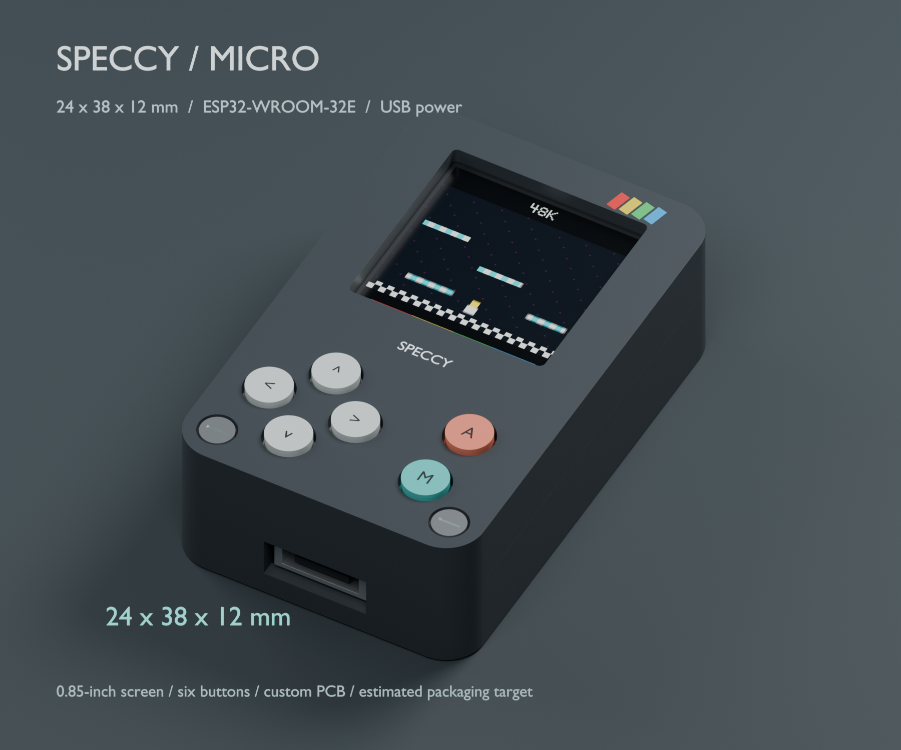

# Especcy — Speccy micro

A compact, USB-powered ESP32 handheld concept for ZX Spectrum games. The repository delivers a **mechanical packaging study** with a **24 × 38 × 12 mm** assembled envelope and **48K bench firmware for original Dizzy**. The envelope includes button caps and excludes the USB cable.



The CAD screen is illustrative artwork. The host emulator and ESP32 firmware builds pass software checks. The [electrical study](hardware/electronics/README.md) adds checked carrier/fixture schematics, exact BOMs and an unrouted placement board. Routing and physical qualification remain open, including recorded thermal and switch/socket fit gates.

## Design baseline

| Item | Current selection or target |
| --- | --- |
| Processor module | ESP32-WROOM-32E-N4 on a custom carrier; the full DevKitC board is excluded |
| Display | Waveshare 0.85-inch LCD, SKU 26117; GC9107; 128 × 128 pixels; 3.3 V SPI |
| Game picture | 2 × 2 averaging to 128 × 96; centered with 16 border-colored rows above and below |
| Controls | Up, Down, Left, Right, Fire, Menu |
| Power | GCT Micro-B power only; TLV75733PDBVR 3.3 V LDO, with input protection and thermal qualification gates |
| Programming | External gated UART fixture; pogo 3V3 is sense only; manual BOOT/RESET |
| Case | Two halves; 24 × 38 × 11.6 mm shell; 12 mm including caps |
| Constraints | Radios disabled; no battery, SD card, speaker or full keyboard |

The compact stack assumes removal of the LCD's MX1.25 connector and replacement with eight wires. Display depths, component packages, wiring, button travel and fabrication tolerances need physical validation.

## Start here

- [Documentation index](docs/README.md): the full suite and reading paths.
- [Firmware guide](firmware/README.md): native checks, diagnostic/Dizzy builds, content preparation, wiring and bench acceptance.
- [Electrical guide](hardware/electronics/README.md): KiCad files, pinouts, exact BOMs, reproduction, fit/thermal findings and [previews](hardware/electronics/previews/index.html).
- [Product brief](docs/product-brief.md): purpose, scope, users and maturity.
- [Requirements catalogue](docs/requirements.md): 38 sourced requirements with status and verification links.
- [Research and sources](docs/research.md): manufacturer checks, implementation evidence and feasibility limits.
- [Decisions](docs/decisions.md) and [requirements review](docs/requirements-review.md): unresolved choices and supported findings.
- [Development guide](docs/development.md): CAD rebuilds, checks and artifact maintenance.

## Open the design

| Artifact | Use |
| --- | --- |
| [FreeCAD model](hardware/cad/models/speccy_micro.FCStd) | Edit native solids, shell history and the dimension spreadsheet |
| [Blender presentation](hardware/cad/models/speccy_micro.blend) | View assembled, exploded, size comparison and programming access scenes |
| [STEP assembly](hardware/cad/models/speccy_micro_assembly.step) | Exchange CAD geometry in millimetres |
| [GLB assembly](hardware/cad/models/speccy_micro.glb) | View the portable model in metres |
| [Print meshes](hardware/cad/meshes/) | Inspect two case halves and six plungers in millimetres |
| [Original CAD package](hardware/cad/speccy_micro_package.zip) | Download the existing 27-file CAD bundle; the new root documentation is outside this archive |
| [CAD notes](hardware/cad/README.md) | Read the original packaging assumptions and commands |

## Verification status

On **2026-10-03**, the documentation review reopened all 47 native FreeCAD component shapes, checked the STEP envelope and validity, checked eight closed STL meshes, and ran the saved Blender validator successfully. The CAD archive matched its 27 source files.

The stored mechanical report records no tested primary-part collisions. These checks establish properties of the digital models. Three native test suites pass under sanitizers, both ESP32 content modes build, and original Dizzy starts and responds to movement/jump in the host emulator. Electrical operation, physical LCD/input behavior, real-time performance, heat and assembly remain unverified. See the [verification plan and results](docs/verification.md).

## Rebuild

Run from the repository root with FreeCAD and Blender installed at the paths shown. These commands overwrite generated CAD assets and renders.

```sh
QT_QPA_PLATFORM=offscreen /Applications/FreeCAD.app/Contents/Resources/bin/python -u hardware/cad/scripts/build_freecad.py
/Applications/Blender.app/Contents/MacOS/Blender --background --factory-startup --python hardware/cad/scripts/build_blender.py
/Applications/Blender.app/Contents/MacOS/Blender --background hardware/cad/models/speccy_micro.blend --python hardware/cad/scripts/validate_blender.py
```

The checked tools were FreeCAD 1.1.4 and Blender 5.2.2 LTS. See the [development guide](docs/development.md) before changing dimensions: several placements are explicit constants, and `parameters.json` does not drive every shape.

## Project status and licensing

The [roadmap](docs/roadmap.md) records the authorized firmware/electrical phases and the open hardware gate. The selected workload is original Dizzy on Spectrum 48K, using ESP-IDF v5.4.4 and a pinned GPLv3 Z80 core. Product ownership, budgets, dates and wider acceptance criteria remain open.

The new firmware uses [GPL-3.0](firmware/LICENSE), with dependency notices retained. The original CAD/documentation license and ROM/game distribution rights remain unresolved; private game assets and generated builds are ignored. See D-012 and D-013 in the [decision register](docs/decisions.md).
