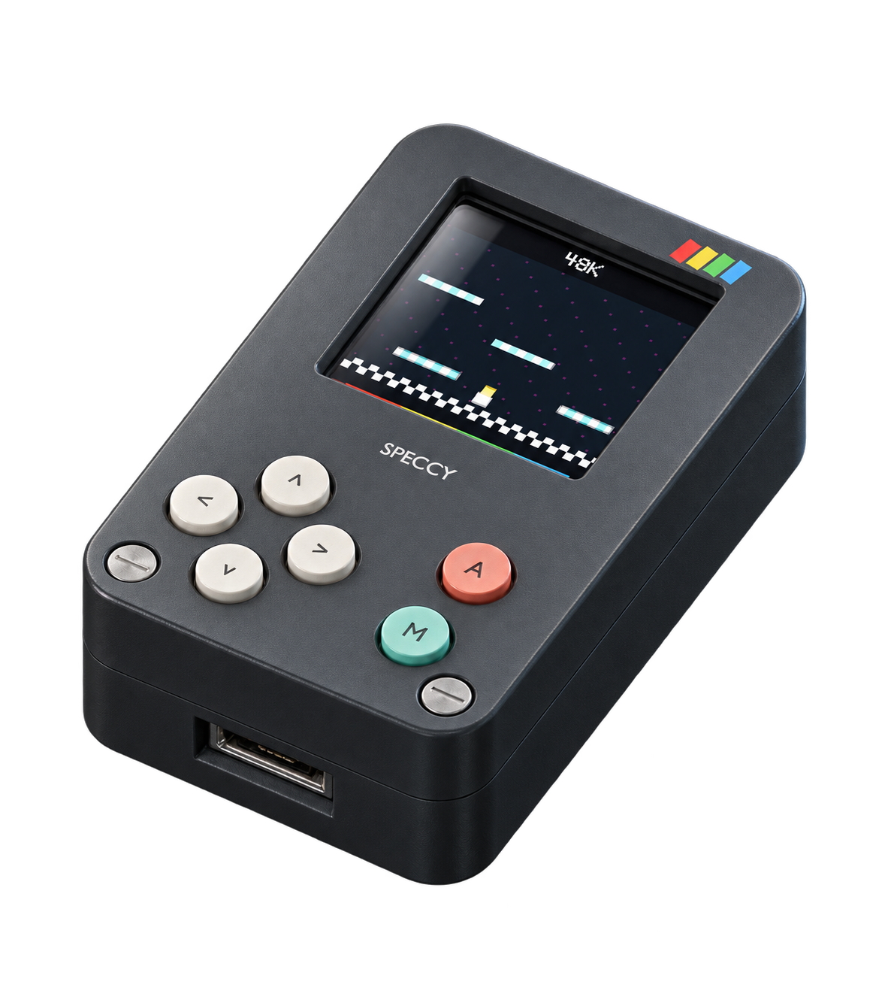
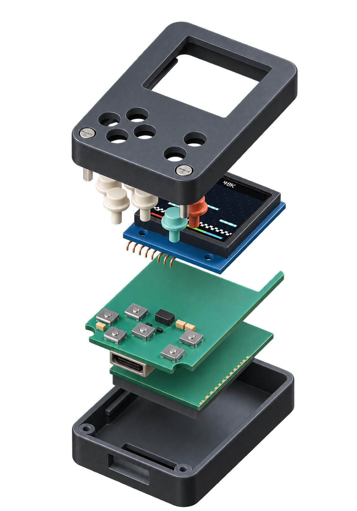
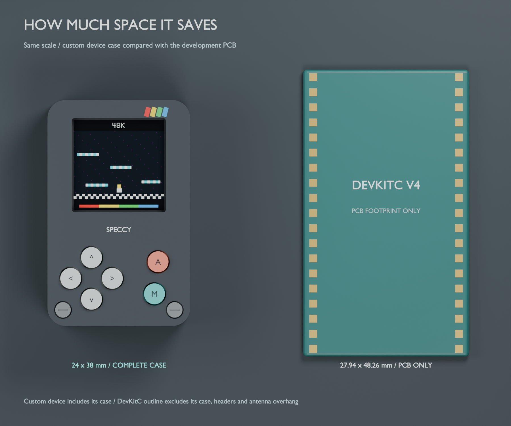
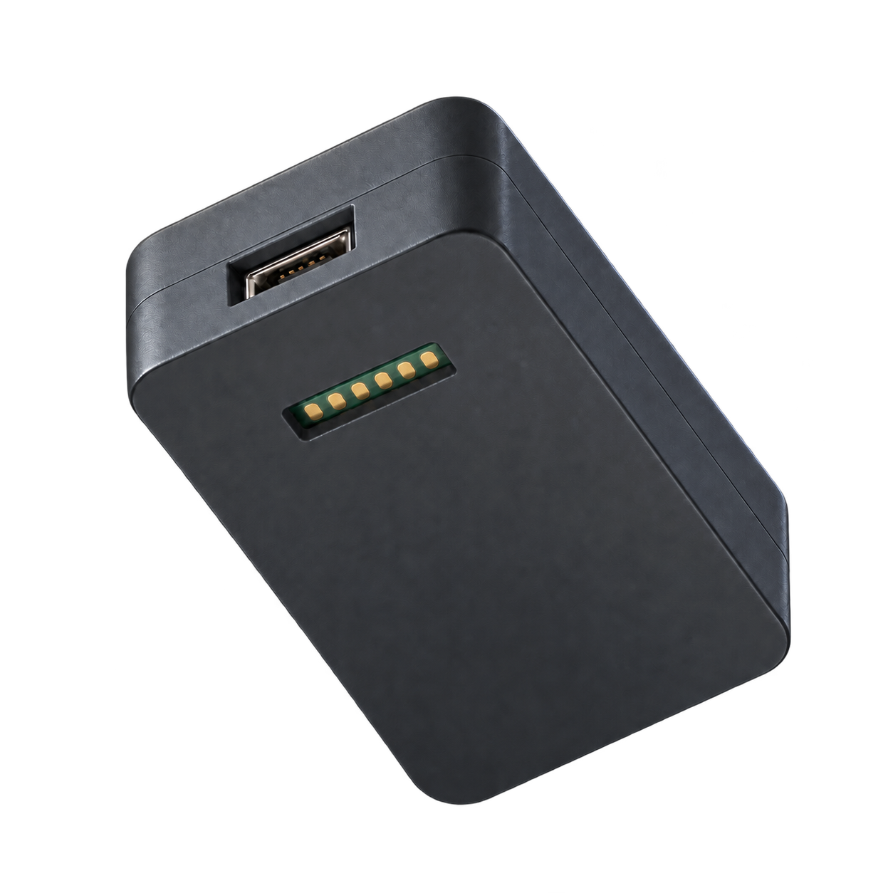
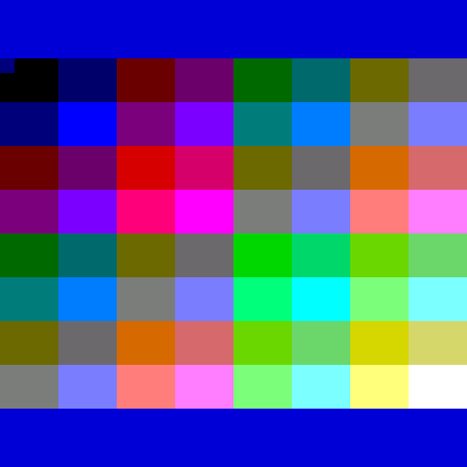

# Speccy micro

**A thumb-sized ESP32 handheld for ZX Spectrum games: 24 × 38 × 12 mm, designed from case to firmware.**

[](https://github.com/5haman/especcy/actions/workflows/ci.yml)
[](LICENSE)
[](LICENSE-HARDWARE)
[](LICENSE-DOCS)

<p align="center">
  
</p>
<p align="center"><sub>Concept visual based on the CAD model. The device has not been built yet.</sub></p>

Especcy explores how small a playable ZX Spectrum handheld can be. An ESP32-WROOM-32E module, a 0.85-inch 128 × 128 LCD, six buttons and a USB power socket fit in a two-part case. The repository holds the complete digital design:

- **Mechanical:** a scripted FreeCAD model with 47 components, automatic collision and envelope checks, STEP/STL/GLB exports and a Blender presentation.
- **Electrical:** KiCad 10 schematics for the carrier board and its programming fixture. Python generates them, every ERC rule passes, and the BOMs name exact parts.
- **Firmware:** a cycle-timed Spectrum 48K emulator in C++14 for ESP-IDF, with a GC9107 LCD driver, debounced controls and a pause menu.
- **Documentation:** 38 requirements with traceability, 17 verification scenarios, decision and risk registers, and an eight-page [product prospectus](docs/prospectus/speccy-micro-prospectus.pdf).

## Engineering highlights

- **Accurate 48K timing.** Each frame runs 69,888 T-states in 19,968 µs (about 50.08 Hz), with the 48K memory and I/O contention pattern. Instruction overshoot carries into the next frame, so emulated time does not drift.
- **256 × 192 pixels on a 128 × 128 screen.** The renderer averages each 2 × 2 block into one RGB565 pixel. The 128 × 96 picture sits between 16-row bands in the border colour. One 32 KiB DMA framebuffer feeds the LCD at about 25 fps.
- **A real game, with no bundled content.** The original *Dizzy* (1987) starts, walks and jumps in the host emulator. A 15,000-frame run is clean under AddressSanitizer and UndefinedBehaviorSanitizer. The repository ships only a project-authored diagnostic; offline tools convert your own snapshots.
- **Radios off by construction.** The firmware links no Wi-Fi, Bluetooth or PSRAM component, and it fails to compile if their configuration returns.
- **Generated, cross-checked hardware.** `design.py` drives the KiCad schematics and board. The checker matches every pin, part number and BOM row against the firmware GPIO map, and three deliberately miswired netlists must fail.
- **Open problems stay visible.** The study records its thermal and fit gates: the 560 mA supply budget gives 0.952 W of regulator loss at 5 V, and DRC keeps one known USB-stake/switch conflict on record.

## Gallery

<table>
  <tr>
    <td width="50%"></td>
    <td width="50%"></td>
  </tr>
  <tr>
    <td>Six layers: front shell, button plungers, LCD, carrier with switches, ESP32 module and rear shell. Concept visual.</td>
    <td>Carrier placement from KiCad: six switches, the regulator and the LCD wire pads around the WROOM module.</td>
  </tr>
  <tr>
    <td></td>
    <td></td>
  </tr>
  <tr>
    <td>The complete case beside a bare ESP32 DevKitC V4 board at the same scale. CAD render.</td>
    <td>Underside: the Micro-B power socket and six contacts for an external UART programming fixture. Concept visual.</td>
  </tr>
</table>

The [carrier schematic](hardware/electronics/previews/carrier.svg) and [fixture schematic](hardware/electronics/previews/fixture.svg) are also available as SVG.

## Status

The digital design is complete and checked. Building and testing a physical prototype is the next step.

| Area | State | Evidence |
| --- | --- | --- |
| Enclosure CAD | Done | 47 valid solids, no primary collisions, 24 × 38 × 12 mm envelope; valid STEP and eight closed STL meshes |
| Firmware | Ready for bench tests | Three sanitizer test suites pass; diagnostic and Dizzy images build with ESP-IDF v5.4.4 |
| Schematics and BOMs | Done | Carrier and fixture are ERC-clean with all rules; firmware, BOM and netlist agree |
| PCB layout | Placement only | Routing waits for measured parts; DRC keeps one known USB/switch conflict |
| Physical prototype | Not built | LCD, controls, real-time speed, heat, fit and programming need hardware tests |

The [roadmap](docs/roadmap.md) lists the open gates, and [verification](docs/verification.md) records every check that has run.

## Try it without hardware

You need CMake, a C++14 compiler and Python 3. No ROM or game is needed: the build generates its own diagnostic content.

```sh
cmake -S firmware -B firmware/build-host -DSPECCY_HOST=ON -DCMAKE_BUILD_TYPE=Debug
cmake --build firmware/build-host
ctest --test-dir firmware/build-host --output-on-failure

cd firmware/build-host
./speccy-host --rom content/spectrum48.rom --snapshot content/game48.sna \
  --frames 50 --buttons 9 --output frame.ppm
python3 ../tools/ppm_to_png.py frame.ppm frame.png --scale 4
```



The last two commands make this frame: the diagnostic test card as the emulator sends it to the 128 × 128 LCD, scaled 4×. The border is blue because the diagnostic copies the low three bits of the Kempston mask to the border port; `--buttons 9` holds Right and Up.

- **ESP32 firmware:** install ESP-IDF v5.4.4 and run `idf.py -B build-esp32 build` in `firmware/`. The [firmware guide](firmware/README.md) covers wiring, flashing, game content and the bench checklist.
- **Electrical study:** `python3 hardware/electronics/check.py` checks the stored results; the [electrical guide](hardware/electronics/README.md) rebuilds them with KiCad.
- **CAD:** the [development guide](docs/development.md) rebuilds the models, renders, export checks and the downloadable CAD package with FreeCAD and Blender.

<br clear="right">

## Design baseline

| Item | Selection |
| --- | --- |
| Processor | ESP32-WROOM-32E-N4 (4 MB flash, no PSRAM) on a custom 20.8 × 34.8 mm carrier |
| Display | Waveshare 0.85-inch LCD, SKU 26117: GC9107, 128 × 128, 3.3 V SPI; connector replaced by eight wires |
| Picture | 2 × 2 averaging to 128 × 96, centred between 16-row border bands |
| Controls | Up, Down, Left, Right, Fire (Kempston) and Menu (Resume/Restart) |
| Power | Micro-B, power only; TLV75733P 3.3 V LDO with a resettable fuse and TVS diode |
| Programming | External UART fixture on six underside pads; manual BOOT and RESET |
| Case | Two halves, 24 × 38 × 11.6 mm; 12 mm including button caps |
| Excluded | Battery, SD card, speaker, keyboard, Wi-Fi and Bluetooth |

## Repository layout

```text
firmware/              ESP-IDF project, shared emulator core, host runner, tests and tools
  common/              Spectrum 48K machine, video scaling, controls and menu (host and ESP32)
  main/                ESP32 entry point, GC9107 SPI driver, frame pacing and UART reports
  host/                Headless runner that writes PPM frames and JSON metrics
  tests/               CTest suites: runtime, command line and snapshot converter
  tools/               Content packaging, Z80-to-SNA conversion and PPM-to-PNG export
  vendor/              Pinned z80cpp core and the Waveshare driver notice
hardware/cad/          FreeCAD and Blender scripts, models, meshes, renders and check reports
hardware/electronics/  KiCad carrier and fixture, BOMs, generator, checks, reports and previews
docs/                  Requirements, architecture, verification, decisions, risks and prospectus
.github/workflows/     CI: host tests on GCC and Clang, ESP32 build, electrical and link checks
```

## Documentation

- [Product prospectus (PDF)](docs/prospectus/speccy-micro-prospectus.pdf): an eight-page visual introduction.
- [Documentation index](docs/README.md): the full engineering suite and reading paths.
- [Firmware guide](firmware/README.md), [electrical guide](hardware/electronics/README.md) and [CAD notes](hardware/cad/README.md).
- [Requirements](docs/requirements.md), [verification](docs/verification.md), [decisions](docs/decisions.md) and [risks](docs/risks.md).

## License

Copyright © 2026 Serhii Shyman. Each kind of file has its own license:

| Files | License |
| --- | --- |
| Source code and scripts: `firmware/`, every `*.py` file and `.github/` | [GPL-3.0](LICENSE) |
| Hardware design files: everything else in `hardware/` (CAD models, meshes, KiCad sources, BOMs, reports and previews) | [CERN-OHL-S-2.0](LICENSE-HARDWARE) |
| Documentation and images: Markdown files, the rest of `docs/` and the PNG renders | [CC BY-SA 4.0](LICENSE-DOCS) |

Third-party files keep their own terms. The [z80cpp core](firmware/vendor/z80cpp/UPSTREAM.md) is GPLv3, the [Waveshare notice](firmware/vendor/waveshare/NOTICE) covers the adapted LCD start-up sequence, and the KiCad library snapshots use CC BY-SA 4.0 with the KiCad library exception ([notice](hardware/electronics/NOTICE)). The CERN-OHL-S source location is <https://github.com/5haman/especcy>.

The repository contains no Spectrum ROM, game, game screenshot or game firmware image. Use your own legally obtained files for local builds. This is an unofficial hobby project, not affiliated with the owners of the ZX Spectrum or *Dizzy*, or with the manufacturers named here.
