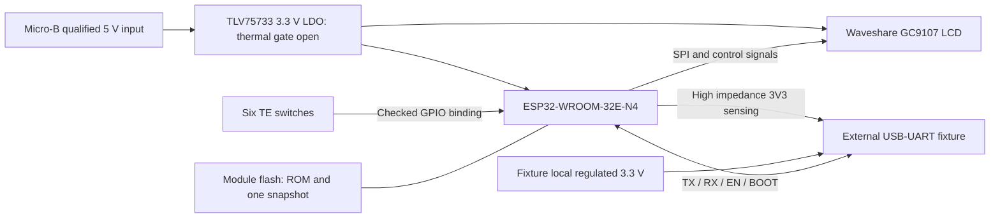
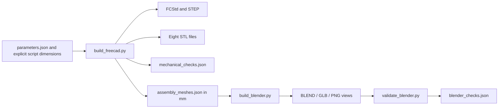

# Architecture

The implemented software includes a **CAD generation pipeline** and a **Spectrum 48K bench runtime**. The product remains a USB-powered ESP32, LCD and six controls inside the modeled enclosure. Firmware builds and host checks do not establish physical operation or fit.

## Product structure

The diagram describes the connections in the electrical study. Carrier and fixture schematics now match the bench firmware bindings. Routing and physical connection evidence remain open.

Micro-B supplies the handheld only. The manual UART fixture buffers both directions and receives independent local power; the device's 3V3 pogo pad is sense only. The selected ESP32 module contains flash; the separate flash box shows its logical use. The enclosure provides underside access. D-007 is selected for this study, with bench validation open. Radios remain disabled under CON-005.

## Mechanical structure

| From rear toward front | Modeled relationship |
| --- | --- |
| Rear shell | Floor, carrier ledges, USB opening and programming access |
| ESP32 module and Micro-B socket | Beneath the carrier; ESP32 shield faces the rear |
| Custom carrier | Switches and power-component envelopes above; module, socket and pads below |
| LCD and interconnect | Display above the carrier; removed connector replaced by eight illustrative wires |
| Gasket and plungers | Gasket at the display roof interface; collars capture the six plungers |
| Front shell | Display window, button apertures and two screw positions |

The stack uses overlapping XY regions at different heights. The [hardware specification](hardware.md) gives the dimensions and evidence limits. The [exploded render](../hardware/cad/renders/exploded.png) shows the same solids with artificial separation for inspection.

## CAD pipeline

FreeCAD constructs the solids, validates them, exports print/exchange geometry and writes tessellated component meshes. Blender imports those meshes at a scale of `0.001`, adds presentation elements and saves the views. Its validator reopens the saved model and checks names, size, texture, previews and the GLB header.

`check_exports.py` reads the exported STEP and STL files and rewrites `export_checks.json`. `package.py` builds the downloadable archive from committed files. Both run after the sequence above; see F-003 and the [development guide](development.md).

## Source authority and change coupling

`parameters.json` is a record of nominal dimensions and assumptions, not a complete geometry generator. Some placements use it directly; others use numeric constants in `build_freecad.py`. The spreadsheet controls some shell expressions. Blender also includes explicit placements and size labels.

For a dimensional change, review all three sources: parameters, geometry construction and presentation labels. A saved spreadsheet edit alone is lost on the next scripted rebuild unless the script is updated. This is an implemented limitation, not an inferred optimization feature.

## Implemented firmware boundaries

U2 selects original Dizzy on a 48K Spectrum and ESP-IDF v5.4.4. A single main task on CPU1 polls inputs, runs one emulated frame, renders every second tick and sends the LCD buffer. It yields during the wait to the next 19,968 µs deadline. No additional game task or networking layer is required.

| Source | Responsibility | Evidence boundary |
| --- | --- | --- |
| `firmware/vendor/z80cpp/` | Pinned Z80 execution core | GPLv3; one marked prefix-state accessor for host capture |
| `firmware/common/` | 48K memory/ports, contention, interrupts, SNA load/capture, pixel conversion, debounce and menu | Shared by host and ESP32; sanitizer-enabled tests |
| `firmware/host/` | Headless execution, PPM output, offline K selection and SNA capture | Local game checks; no hardware timing claim |
| `firmware/tools/` | Diagnostic generation, local content validation/manifest and offline Z80-to-SNA conversion | No commercial assets needed for tests; device accepts SNA only |
| `firmware/main/` | GPIO, manufacturer-based GC9107 driver, pacing and UART metrics | Builds for ESP32; LCD/input/timing require the bench |

The 48 KiB machine RAM lives in internal DRAM. ROM and initial SNA remain in mapped flash. One 32 KiB DMA framebuffer is allocated at startup. The minimal IDF component set excludes Wi-Fi, Bluetooth and PSRAM. The firmware does not initialize radios.

See the [firmware guide](../firmware/README.md) for exact versions, builds, memory evidence and bench steps. VGA, PS/2 and SD code from the full ESPectrum application are not used.

## Boundaries of trust and operation

There are no accounts, network services, remote telemetry or remote update channels. The external programmer, firmware image and compiled content are the input boundaries. Build and boot checks reject invalid supported content; errors stop emulation and recovery uses a UART reflash. UART metrics remain local. No secure-boot, flash-encryption or authorization scheme has been selected.

Sources: L1–L5/L9, U2 and W1–W11 in [research](research.md). For the logical connections and data contract, continue to [interfaces and firmware](interfaces-and-firmware.md).
